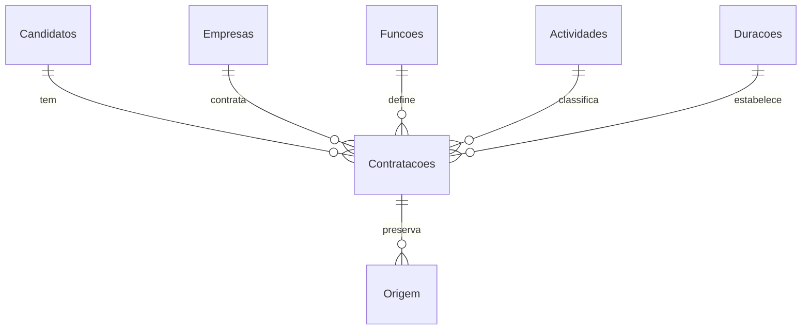

# Emigrantes · Portugal

Aplicação de secretária em português para registar trabalhadores e ligar os seus contratos a empresas em Portugal. A base de dados é um ficheiro `.xlsx`, sem servidor ou base SQL.

A interface usa navegação lateral, fundo claro, verde profundo, listas paginadas, pesquisa, filtros por empresa e função, formulários de edição e uma área de revisão da importação. Não contém registos fictícios. O primeiro arranque cria uma base vazia; pode importar o documento existente ou abrir uma base já normalizada.

## Executar no Windows

Requer Windows 10 (19041 ou posterior), .NET SDK 10 e a workload MAUI para Windows. Pode abrir `EmigrantesPort.slnx` no Visual Studio com suporte para .NET 10 e desenvolvimento MAUI/WinUI.

```powershell
dotnet workload install maui-windows
dotnet restore EmigrantesPort.slnx
dotnet build EmigrantesPort/EmigrantesPort.WinUI/EmigrantesPort.WinUI.csproj -p:Platform=x64
dotnet run --project EmigrantesPort/EmigrantesPort.WinUI/EmigrantesPort.WinUI.csproj -p:Platform=x64
```

O executável WinUI e o seu compilador XAML requerem Windows. No Linux é possível compilar o projecto partilhado e executar a normalização, as consultas e as verificações da camada Excel; não é possível executar a interface WinUI.

## Utilização

1. Use **Importar Excel** para ler o documento original. A aplicação apresenta o resultado antes de o incorporar na base actual. O original nunca é alterado.
2. Em **Empresas**, **Funções**, **Actividades** e **Durações**, adicione ou edite os nomes usados nos formulários. Os nomes são únicos, ignorando maiúsculas, acentos e espaços adicionais.
3. Use **Registar candidato** para criar uma pessoa e o seu contrato. Também pode seleccionar uma pessoa existente para lhe associar outra contratação.
4. Pesquise por nome, empresa, função, contacto, actividade ou duração; combine com os filtros de empresa e função. **Editar** modifica o registo, **×** remove a contratação. O candidato só é removido quando já não tem contratações.
5. Cada alteração é gravada automaticamente na base Excel. A versão anterior fica em `CopiasSeguranca`, junto do ficheiro. **Localização e segurança** mostra o caminho completo. As cópias ficam disponíveis até serem removidas pelo utilizador.
6. **Guardar cópia** abre o diálogo Windows para exportar a base completa, incluindo a folha de consulta. **Abrir base** abre um ficheiro normalizado ou uma cópia de segurança. O último caminho é recordado.
7. Se editar directamente no Excel, use as tabelas normalizadas, preserve os IDs e as referências, feche o Excel e escolha **Reabrir a base**. Se houver alterações externas, a aplicação impede a sobrescrita com dados antigos. A folha Consulta é regenerada na próxima gravação.

Salários são introduzidos em euros com vírgula decimal, por exemplo `920,00` ou `1.150,50`. Salário e contacto podem ficar por indicar. Novos contratos requerem nome, empresa, função, actividade e duração. Registos incompletos importados são preservados e assinalados para revisão.

## Modelo normalizado

Todos os IDs e contactos são texto. Os IDs são UUIDs estáveis, independentes dos nomes. Não se utiliza a coluna `Ord.` como chave: o documento fornecido contém ordens repetidas.

| Folha | Colunas | Regra |
| --- | --- | --- |
| Candidatos | Id, Nome, Contacto | Uma pessoa pode ter vários contratos; nomes de pessoas não são únicos. |
| Empresas | Id, Nome, Observacao | Nome único; observações diferentes da origem são conservadas em linhas separadas na célula. |
| Funcoes | Id, Nome, Descricao | Nome único. |
| Actividades | Id, Nome, Descricao | Nome único. |
| Duracoes | Id, Nome, Descricao | Nome único; variantes conhecidas de «12 meses» são unificadas. |
| Contratacoes | Id, CandidatoId, EmpresaId, FuncaoId, DuracaoId, ActividadeId, Salario, ObservacaoOriginal | Guarda as ligações, salário e observação específica da linha original. |
| Consulta | ContratacaoId e todos os dados legíveis reunidos | Vista gerada com os nomes dos catálogos, sem obrigar a consultar os IDs. |
| Origem | Id, ContratacaoId, Ficheiro, Folha, Linha, ValoresOriginais | Preserva os valores de todas as colunas importadas em JSON. Linhas sem candidato têm ContratacaoId vazio. |
| Revisao | Id, Origem, Mensagem | Relatório histórico de inconsistências detectadas na importação. |
| Configuracao | Identificador e versão do formato | Identifica uma base normalizada suportada pela aplicação. |



Função, empresa, actividade e duração pertencem à contratação, permitindo que a mesma pessoa tenha diferentes condições em contratos diferentes. A lista de candidatos apresenta estes atributos através das relações. Uma empresa ou entrada de catálogo ligada a contratos não pode ser removida sem primeiro alterar essas ligações.

### Decisões de importação do documento fornecido

Foram analisadas todas as folhas: `Folha2` está vazia; `Folha1` e `Folha3` contêm dados e sobreposição. Cabeçalhos incompletos como «Duração do» e a coluna de actividade sem título são reconhecidos pelo formato original.

- Linhas com os mesmos dados de pessoa, empresa, função, duração, actividade, salário e observação são reunidas numa contratação, preservando todas as origens.
- Candidatos com o mesmo nome normalizado e contacto não vazio são reunidos. Sem contacto, pessoas não são automaticamente fundidas apenas pelo nome. Esta identificação deve ser confirmada quando houver homónimos ou contactos partilhados.
- Espaços, caixa e acentos são ignorados na comparação de nomes. A grafia da primeira ocorrência é mantida. Possíveis erros de escrita não são corrigidos por aproximação: podem designar entidades distintas.
- Durações equivalentes são normalizadas; «indeteriminado» é convertido em «Indeterminado». Valores desconhecidos são conservados.
- Observações divergentes da empresa são preservadas e sinalizadas; a observação de cada linha permanece na contratação. Não se escolhe automaticamente um ano de fundação.
- Contactos vazios, salários inválidos, campos em falta e colunas adicionais ficam sinalizados. Os valores originais permanecem disponíveis.
- Linhas sem nome mas com outros valores ficam em Origem e Revisao, sem criar pessoas fictícias. Algumas parecem linhas de modelo, pelo que precisam de confirmação.
- Fórmulas da origem são lidas pelo seu valor guardado, sem execução. Fórmulas nas tabelas de uma base normalizada são rejeitadas. Texto iniciado por `=` é gravado como texto.

A importação verificada produziu **2 561 contratações**, **2 519 candidatos**, **995 empresas** e **487 funções**, com **942 linhas repetidas** reunidas e **23 linhas sem candidato** preservadas. No total, **3 526 linhas com dados** ficaram em Origem. Os **1 449 avisos** são pontos de revisão e podem existir vários na mesma linha; não representam 1 449 candidatos inválidos. Reimportar o mesmo documento não volta a criar registos ou avisos.

O relatório Revisao é histórico, não uma lista de pendências com estado resolvido. A pesquisa e os formulários permitem corrigir os registos importados; a origem continua a documentar os valores recebidos. O documento original e a base produzida não são incluídos no Git.

## Ferramentas e verificações

A ferramenta de linha de comandos usa a mesma camada Excel da aplicação e funciona sem interface:

```bash
dotnet run --project EmigrantesPort.Tools -- normalizar "original.xlsx" "nova-base.xlsx"
dotnet run --project EmigrantesPort.Tools -- consultar "nova-base.xlsx" "pesquisa"
dotnet run --project EmigrantesPort.Checks
dotnet run --project EmigrantesPort.Checks -- "/caminho/documento-original.xlsx"
```

A classe `WorkbookSession` coordena abertura, edição e importação. Alterações só se tornam visíveis depois de serem gravadas com sucesso; falhas preservam a sessão anterior. A importação trabalha numa cópia e só é aplicada quando todas as folhas são processadas. Preparações antigas são rejeitadas se a base tiver mudado entretanto. A interface está separada em composição visual, operações e formulários.

O workflow `.github/workflows/build.yml` executa as verificações Excel no Linux e compila o executável WinUI no Windows a cada push ou pull request. Estes resultados automáticos devem ser consultados no GitHub; a execução visual da aplicação continua a exigir Windows.

A ferramenta recusa um destino existente. As verificações exercitam CRUD, unicidade, relações, preservação de contacto e salário, consulta, cópias de segurança, alterações externas, importação repetida, observações divergentes, dados incompletos e leitura da base normalizada. Quando é fornecido o documento original, verificam também todas as linhas, a leitura após gravação e a integridade do original.

A aplicação está preparada para uso local por um utilizador. Excel não é um servidor transaccional para múltiplos editores simultâneos. Não existem login, sincronização na nuvem ou validação documental de vistos nesta versão.

### Validação realizada neste ambiente

- Compilação do projecto partilhado MAUI e da camada Excel: sem avisos nem erros.
- **48 verificações passaram**, incluindo a importação do documento fornecido.
- O código do diálogo de exportação Windows e o registo dos seus serviços compilaram num projecto de verificação das APIs WinUI.
- A base produzida foi também aberta com um leitor Excel independente: 2 561 linhas na folha Consulta, IDs de texto e 23 origens sem candidato.
- A interface WinUI completa **não foi executada nem validada visualmente** neste ambiente Linux. A compilação final do executável e o funcionamento dos diálogos e da janela devem ser confirmados no Windows.
